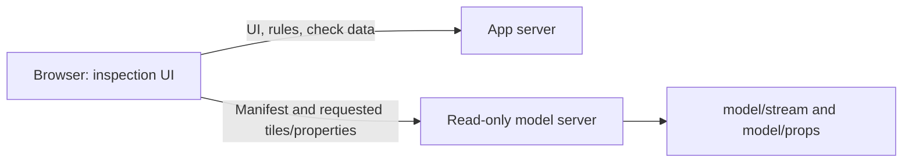

# Viewport streaming

The scenario selector offers the real RCRV, the fictional cruise deck, and the restored **Simplified research vessel (example)**. The example retains its original five decks, 67 elements and 8/8 expected findings; estimated geometry is clearly labelled.

The model server does not load or render ship geometry. The browser reads a 1.4 MB tile manifest and requests only the selected view's tiles. The overview uses original hull/deck geometry; zooming requests nearby checked parts and, with Full model enabled, untested context. A finding requests its component tiles directly. Camera queries are throttled during continuous motion, obsolete requests are cancelled, and offscreen geometry, GPU buffers and picking indices are released. Files can remain in the browser's HTTP cache for revisits.

A wide overview cannot show every tiny component cheaply: detail is intentionally requested on zoom, not downloaded in the background. The default policy limits estimated resident geometry/picking data to 512 MB and nearby non-context detail to 1.5 million triangles. These are client request budgets, not guarantees for total browser RAM or GPU frame rate. A budget message asks the engineer to zoom in when more detail is deferred. Bounds-based selection works at tile granularity; a requested tile can contain neighbouring geometry.

## Export and hosting

Run `node --max-old-space-size=4096 tools/export/tile-model.mjs` from `shipcheck/` after the original GLBs are present. It writes 851 spatial tiles (352.4 MB total) in `model/stream/`, with at most 160,000 triangles per tile. Every decoded position, normal, objectid and index byte is checked after compression. All 50,839,715 triangles from the existing packed GLBs are retained, without additional quantization or simplification. The originals and cached SVF are retained. Content-hashed filenames permit immutable caching; the manifest is replaced atomically.

See [separate model server](../model-serving.md) for `MODEL_BASE_URL`, `MODEL_DIR`, CORS, Range requests, Docker and two-host commands. The app and model server were verified on different local origins. No cloud deployment was run; geometry files remain gitignored and need a separate upload to the model host. The previous full-load viewer remains in `public/viewer-local.js`; APS and screenshot fallbacks remain available.

## Browser verification

Local Chrome, 1680 x 1000 window. These are local test results, not predictions for an internet connection or a different GPU.

| View | Geometry downloaded/resident |
| --- | --- |
| Overview | 102 hull/deck tiles, 34.8 MB transferred; no interior detail requested |
| Zoomed region | 57 resident tiles, 3.40 million triangles; 71 previous tiles released |
| Selected hatch P3522 | 1 tile, 176.7 KB payload, 23,618 triangles, 1.85 MB estimated resident geometry/picking data |
| Pan entirely away from ship | All 102 overview tiles released; returning requests them again |

The overview's geometry was ready about 1.1 s after viewer creation in the warmed run (application/check data loading is additional). The simplified scenario, component and rule views, hatch what-if edit, deck cut, cruise C2 edit and full demo passed. The continuous-pan regression was reproduced and fixed. Explicit `?noaps` works, and simulated geometry-server plus APS unavailability switches to screenshots instead of a blank local viewport. All 71 Node tests pass. Rules and the deterministic checker were not changed.

Screenshots: [simplified example](simplified-example.png), [real-model overview](overview.png), [selected component](component.png).
